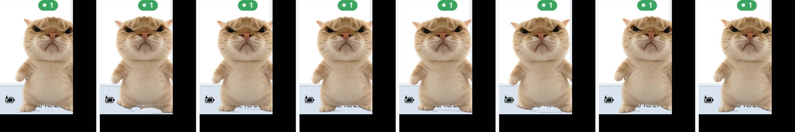

# 哈基米桌宠

一只常驻 Windows 桌面的哈基米猫猫桌宠，专为 **DeepSeek Harness** 服务：显示正在运行的对话数，鼠标移到身上会**抬脚原地跑**，单击唤出 DSH。

**原生实现，不是 Electron。** 单文件 671 KB，常驻内存约 43 MB。



---

## 一条命令安装

```bash
npx hajimi-pet-cli install hajimi-desktop-pet
```

安装器会：识别 Windows / x64 → 把 **671 KB 的原生 exe** 复制到本机 → 创建开始菜单快捷方式（可选桌面 / 开机自启），并打印安装位置与体积。

> 桌宠本体不需要 Node.js，只有这条安装命令需要。

### CLI 命令

```bash
npx hajimi-pet-cli install [id]      # 安装（默认 hajimi-desktop-pet）
npx hajimi-pet-cli list              # 查看已安装桌宠
npx hajimi-pet-cli update [id]       # 用当前包版本覆盖安装
npx hajimi-pet-cli uninstall [id]    # 卸载并清理快捷方式
npx hajimi-pet-cli --help
```

选项：`--desktop`、`--autostart`、`--no-shortcut`、`--verbose`。

---

## 交互

| 操作 | 效果 |
| --- | --- |
| **单击猫** | 说一句话 + 唤出 DeepSeek Harness |
| **双击猫** | 摸头 |
| **拖动** | 移到任意位置，松手自动贴回屏幕内 |
| **右键猫** | 弹出菜单 |
| **点头顶数字** | 展开「正在运行」的对话标题列表 |
| **点列表里的标题** | 唤出 DSH + 把标题复制到剪贴板 |
| **鼠标停留在猫身上** | 有任务在跑 → **双脚交替抬起、绕脚踝滚动、身体起伏前倾（原地跑）**；没任务 → 只做轻微呼吸与随鼠标转头 |

托盘图标（猫头）：左键显示/隐藏；右键有实时统计与大小档位（72 / 104 / 140 / 180）。

## 头顶的数字

- 只显示**正在运行**的对话数；有任务在跑时变绿
- 0 时是灰底，不打扰
- 点它展开正在运行的对话标题（带相对时间）
- 数字变化时会跳一下

## 数据来源

只读 DeepSeek Harness 自己的会话缓存：

```
%USERPROFILE%\.dsh\storages\session_projcache\sessions\session-<uuid>.json
```

判定「正在运行」的依据：`record.rows.turnBoundary.val.lastStepBoundary.kind === "start"` 且 `openTurnStartSeq > 0`，即这一轮还没收到结束标记。

桌宠**不联网、不上传、不写入**任何 DSH 数据；解析失败的单条会话直接跳过。

---

## 轻量化对比

| | Electron 版（已废弃） | 当前原生版 |
| --- | --- | --- |
| 安装体积 | 78.4 MB | **671 KB** |
| WorkingSet 内存 | 328 MB | **43 MB** |
| Private 内存 | 190 MB | **27 MB** |
| 进程数 | 4（main/gpu/renderer/utility） | **1** |
| 运行时依赖 | 内置 Chromium | .NET Framework 4.8（Windows 自带） |

内存为 Windows 11 x64 静置 5 分钟的实测中位数。

## 技术实现

**分层窗口**：这是一张 3D 渲染图，腿只占约 30px 高，无法靠「整体平移」演出跑步。所以按实测缝隙把它切成图层：

```
pet-torso.png      躯干，最后绘制，压住脚踝切口
pet-leg-left.png   左脚，绕自己的脚踝 (100, 406) 旋转
pet-leg-right.png  右脚，绕自己的脚踝 (272, 406) 旋转
pet-shadow.png     独立柔和地面阴影
```

切割依据（实测）：双脚在 **y=406** 才真正分开，所以从那里切；躯干硬切在 406 并被**最后绘制**，因此脚抬起或旋转时永远不会露出洞。

**透明窗口**：`WS_EX_LAYERED` + `UpdateLayeredWindow` 提交 32 位 ARGB 位图，四周是真 alpha=0；配合 `WS_EX_TOOLWINDOW` 不占任务栏、`WS_EX_NOACTIVATE` 不抢焦点。

**点击穿透**：窗口比猫大（要容纳角标与列表），命中测试只认猫本体的椭圆范围，透明区域完全不吃桌面点击。

**性能**：33ms 定时器重绘；会话扫描 4 秒一次；无任务且鼠标不在身上时几乎只有呼吸动画。

## 项目结构

```
packages/
  native/          C# 原生桌宠（.NET Framework 4.8）
    src/PetForm.cs        分层窗口、跑步动画、角标、列表、拖动
    src/SessionScanner.cs 读 DSH 会话缓存
    src/Program.cs        托盘、单实例、dsh://open
    Assets/               运行时图层（躯干 / 双脚 / 阴影 / 图标）
  cli/             npm 安装器 hajimi-pet-cli
    src/cli.js            安装 / 更新 / 卸载 / 列表
    assets/HajimiPet.exe  随包分发的桌宠本体
    test/cli.test.mjs     12 个端到端用例
tools/
  assets/build_assets.py  从 3D 渲染图抠出主体
  assets/build_layers.py  切成躯干 + 双脚（含实测坐标与不变式说明）
  build-native.mjs        构建 + 拷入 CLI 包 + 刷新 sha256
  selftest_native.py      真实启动自检（10 项）
  verify_install.py       安装 → 启动 → 卸载全链路
  verify_npx.py           npx 真实安装验证
```

## 开发

```bash
npm run assets        # 重建图层素材（需要 Python + opencv + Pillow）
npm run build         # dotnet build + 拷进 CLI 包 + 刷新 sha256
npm run selftest      # 真实启动、截图、检查透明/动画/DSH 数据（10 项）
npm run test:cli      # CLI 端到端测试（12 项）
npm run pack:cli      # 打 npm tarball
```

## 已验证 / 未验证

**Windows 11 x64 实测通过**

- 原生自检 **10/10**：窗口创建、尺寸合理、`WS_EX_LAYERED`、`WS_EX_TOOLWINDOW`、猫已渲染、跑步帧间差异（18.3）、双脚位移（7.7）、读到 DSH 10 个对话（1 个进行中）、三档尺寸生效
- CLI 测试 **12/12**：help/version、未知命令与选项、安装落地、PE 头校验、体积上限、list、update、旧版本清理、卸载清理、重复卸载、未知 ID、sha256 一致
- **`npx` 真实安装**：`npx --yes ./hajimi-pet-cli-1.0.0.tgz install` → 671 KB exe 落地 → 启动 → 分层透明窗口 → `npx list` 正常 → 卸载清理干净
- 安装后启动实测：WorkingSet 42.6 MB / Private 26.7 MB
- 跑步动画通过真实桌面抓屏验证（帧间像素差 14.3）

**未验证**

- Windows 10、多显示器、高 DPI 缩放
- npm 公网发布（需要 npm 凭据；包已在本机打好并验证安装）
- 代码签名（未签名，SmartScreen 首次运行会提示）

## 已知限制

- **点标题无法直接跳进那个会话**。DSH 只注册了 `dsh://open`（聚焦窗口），没有逐会话深链接，也没有命令行入口 —— 详见 [docs/dsh-session-entry.md](docs/dsh-session-entry.md)，那份文档列出了我查过的全部入口与结论。所以这个操作做成：唤出 DSH + 把标题复制到剪贴板。
- 素材只有一个正面机位，跑步是图层旋转模拟，不是真正的骨骼动画；因此在极小尺寸（72px）下腿部动作会不太明显。
- 未做代码签名。

## 许可

MIT。
