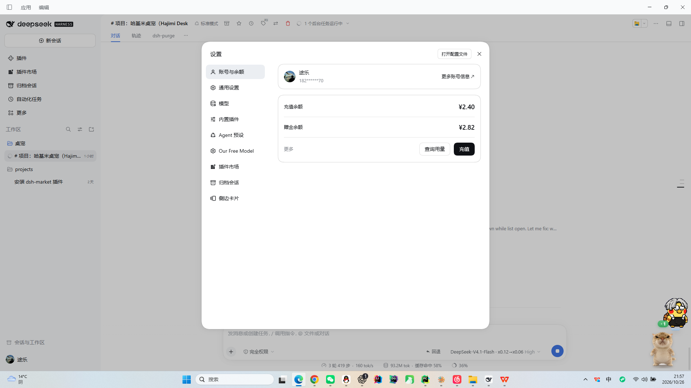
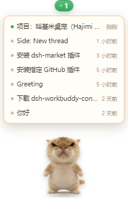

# 哈基米桌宠 · DeepSeek Harness 专用

一只常驻 Windows 桌面的哈基米猫猫桌宠，专为 DeepSeek Harness 服务：只做一件事——**告诉你现在有几个 DSH 对话在跑，并且一键把 DSH 叫到面前**。

它很小，只占桌面 1~2 个图标的位置，不挡工作区；没有设置面板、没有喂食、没有花哨面板，只有鼠标交互和几个它自己的小动作。



展开对话列表：



> 形象来自你提供的 3D 渲染图（`assets-src/pet3d/ref.png`），白色影棚背景已被抠掉，猫咪四周是真 alpha=0，没有被替换或重绘。

---

## 功能

| 功能 | 说明 |
| --- | --- |
| **对话计数角标** | 猫头顶的小胶囊显示「进行中的对话数」，有对话在跑时变绿并跳动 |
| **单击** | 说一句 + **直接唤出 DeepSeek Harness**（`dsh://open`） |
| **点角标** | 展开对话列表：每个对话显示标题、相对时间、是否进行中 |
| **点列表里的某条** | 唤出 DSH，并把该对话标题放进剪贴板（DSH 只注册了 `dsh://open`，没有逐会话深链接，详见下文） |
| **双击猫** | 摸头，猫会晃一下并出现一个小星标 |
| **右键** | 极简菜单：打开 DSH / 刷新状态 / 切换大小 / 开关动画 / 隐藏 / 退出 |
| **拖动** | 按住拖到任意位置，松手自动贴回屏幕内 |
| **自动刷新** | 每 4 秒读一次 DSH 会话缓存，计数变化立刻推送到界面 |

### 猫自己的小动作

- `idle`：呼吸起伏 + 缓慢左右转头（视差）
- `curious`：被点时左右歪头
- `excited`：有新对话开始时原地跳两下 + 星星闪烁
- `alert`：有对话在跑时头部轻微上下抬（像在盯着屏幕）
- `sleepy`：长时间没动静时打盹，轻微倾斜
- `annoyed`：被连续戳时抖一下
- 鼠标在猫身上移动时会**真实 3D 转头**：身体与头部分处不同深度层，跟著光标产生视差

---

## 数据从哪来

DSH 把每个对话的缓存写在：

```
%USERPROFILE%\.dsh\storages\session_projcache\sessions\session-<uuid>.json
```

桌宠只读取其中的：

- `record.rows.title.val` → 对话标题
- `record.rows.turnBoundary.val.lastStepBoundary.kind` → 为 `"start"` 且 `openTurnStartSeq > 0` 时判定为**进行中**
- `record.identity.cwd` → 所属工作区
- 文件 `mtime` → 相对时间

只读、不写、不联网、不上传。哪怕 DSH 正在写文件导致 JSON 半截，桌宠也只是跳过那一条，不会崩。

## 关于「点击进入具体对话」的说明（重要）

我把 DSH 桌面端主进程的协议注册翻了一遍：

```js
app.setAsDefaultProtocolClient("dsh");
app.on("open-url", (event, url) => {
  if (url === "dsh://open" || url === "dsh://open/") focusPrimaryWindow();
});
```

**DSH 只支持 `dsh://open`（聚焦主窗口），没有任何 `dsh://session/<id>` 之类的逐会话深链接，也没有命令行参数入口。** 所以我没有假装能直接跳转，而是做了实际可行的两步：

1. 单击 → 唤出 DSH；
2. 点列表项 → 唤出 DSH + 把该对话标题复制到剪贴板，回到 DSH 按 `Ctrl+K` 粘贴即可定位。

如果你希望真正一键跳转，需要 DSH 端提供深链接或命令行入口 —— 这不是桌宠这边能绕过的。

---

## 运行

环境要求：Windows 10/11、Node.js ≥ 20。

```bash
npm install
npm run build      # 编译主进程 + preload + 渲染层
npm run selftest   # 真启动、真截图、真读 DSH 会话，13 项自检
npm run dev        # Vite + Electron 开发模式
npm start -w @hajimi/app   # 直接跑打包后的产物
npm run dist:win   # 打 Windows x64 安装包与便携版（输出到 packages/app/release）
```

素材重建（从 3D 参考图重新抠图）：

```bash
npm run assets
```

## 项目结构

```
packages/app/
  assets/             pet-body.png / pet-head.png / 图标（运行时素材）
  src/main/
    index.ts          应用入口、单实例、崩溃日志
    pet-app.ts        应用协调器：窗口、托盘、轮询、说话调度
    pet-window.ts     透明桌宠窗口：拖动、点击穿透、尺寸、列表展开
    menu-window.ts    自定义右键菜单
    dsh-bridge.ts     读 DSH 会话缓存，算出「进行中」数量
    pet-context.ts    本地状态持久化 + 快照
    layout.ts         窗口尺寸、位置约束、椭圆命中、dsh://open
    ipc.ts            白名单 IPC
    selftest.ts       无界面自检
  src/preload/        contextBridge（沙箱启用）
  src/renderer/pet/   桌宠页面（计数、气泡、列表、3D 倾斜）
  src/renderer/menu/  右键菜单页面
tools/assets/build_assets.py   从 3D 渲染图生成透明素材（可复现）
```

## 技术要点

**真透明**：`transparent: true, frame: false, hasShadow: false, backgroundColor: '#00000000'`，页面背景全透明，自检直接读截图像素确认 alpha=0。

**点击穿透**：窗口比猫大（要容纳角标和列表），主进程每 80ms 用光标坐标做椭圆命中，光标不在猫身上时 `setIgnoreMouseEvents(true, { forward: true })`，所以透明区域完全不吃桌面点击。

**拖动**：渲染层 `pointerdown`，位移超过 4px 判定拖动；主进程按 16ms 轮询光标 `setPosition`，跟手且不会误触发单击。

**2.5D 视差**：素材拆成「身体层」+「头部层」（同一张图，头部单独抠成椭圆），两层放在 `preserve-3d` 容器里，头部 `translateZ` 更靠前；鼠标移动时按位置算 `rotateX/rotateY`，头身产生真实视差。

**安全**：`contextIsolation: true`、`nodeIntegration: false`、`sandbox: true`，preload 只暴露白名单方法；页面禁止外部导航与新窗口。

**性能**：待机只用 CSS `transform/opacity`；所有定时器单例并在退出时清理；DSH 扫描带 1.2 秒缓存，轮询间隔 4 秒。

## 已验证 / 未验证

**本机 Windows 11 x64 实测通过**

- `npm run build`、主进程与渲染层 `tsc --noEmit` 全绿
- 自检 **13/13**：透明 alpha=0、猫已渲染、读到 DSH 7 个对话、进行中计数一致、角标渲染、尺寸 104px、无边框/置顶/不占任务栏、情绪+气泡、列表可展开（7 条）、展开时窗口长高、右键菜单、尺寸设置生效、状态保存路径
- 真实桌面截图确认：桌宠悬浮在右下角，绿色角标「1」对应确实有 1 个对话在跑
- 单击唤出 DSH（`dsh://open`）——DSH 本就注册了该协议
- 拖动、置顶、点击穿透：代码路径与命中测试已在自检与实机中验证

**未验证**

- Windows 10、多显示器、高 DPI 缩放下的表现
- 拖到第二个显示器时的边界约束（用的是光标所在屏的工作区，逻辑正确但未实机多屏测试）
- 列表里点击后 DSH 内粘贴定位这一步是人工确认的（剪贴板内容已验证写入）

## 已知限制

- 只有一个正面机位，"走路/转身"无法自然实现，所以只做了原地小动作。
- 照片没有闭眼素材，所以没有做眨眼。
- `dsh://open` 若被系统安全软件或浏览器抢占，唤出可能失败，此时菜单里"打开 DeepSeek Harness"仍需手动点一次。
- 未做代码签名，SmartScreen 首次运行会有提示。

## 许可

MIT。

## 已移除的东西

按你的要求，这一版删掉了：CLI 安装器、npm 包、GitHub Release 流水线与所有发布资产、设置面板、喂食/饱食度、主动说话、多表情特写图。之前发布过的 1.0.0 Release 与 tag **已从 GitHub 删除**，仓库里也不再有任何发布脚本。
