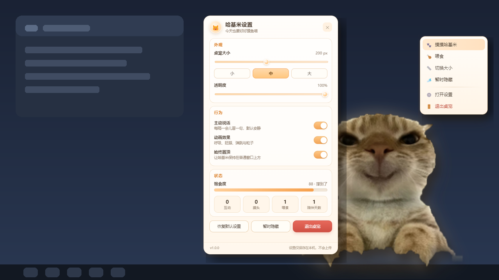
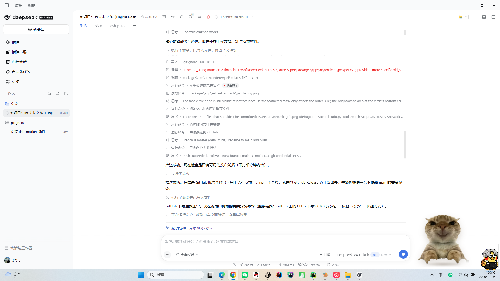

# 哈基米桌宠 · Hajimi Desktop Pet

一只常驻 Windows 桌面的哈基米猫猫桌宠。它不是网页、不是浏览器标签页，而是一个真正无边框、真透明的桌面窗口：会呼吸、会眨眼、会跟着鼠标转头（3D 视差）、能被拖动、能摸头、能喂食，还会在你不理它的时候突然吐槽一句。



真实桌面效果（无边框、真透明、悬浮在普通窗口上方）：



> 形象完全来自项目作者提供的真实照片（`assets-src/new/*.jpg`），没有替换成别的猫，也没有重绘成卡通形象。所有"表情"都是同一只猫的真实照片：眯眼笑、露牙傻笑、震惊张嘴。

---

## 一条命令安装

```bash
# ✅ 现在就能用（CLI 直接从 GitHub Release 拉取，无需 npm 发布）
npx --yes https://github.com/xtf666666-student/Hajimi/releases/download/v1.0.0/hajimi-pet-cli-1.0.0.tgz install hajimi-desktop-pet
```

安装器会：识别 Windows / x64 → 从 GitHub Releases 下载便携版 → 校验 SHA-256 → 安装到本机 → 创建开始菜单快捷方式（加 `--desktop` 同时创建桌面快捷方式）。桌宠本体**不需要用户预装 Node.js**。

等 CLI 发布到 npm 之后（见 [docs/RELEASE.md](docs/RELEASE.md)，只差一个 `npm publish`），命令会简化为：

```bash
npx hajimi-pet-cli install hajimi-desktop-pet
```

也可以直接下载 `HajimiDesktopPet-Portable-1.0.0-x64.exe` 双击运行，或用 `HajimiDesktopPet-Setup-1.0.0-x64.exe` 走安装向导。

> 发布状态：GitHub Release `v1.0.0` **已发布**，安装包、`SHA256SUMS.txt`、`pets.json`、CLI tarball 均已上传；上面的 `npx` 命令已在 Windows 11 实机跑通（下载 80.7 MB → SHA-256 → 安装 → 开始菜单快捷方式 → 启动）。npm 包尚未发布（缺少 npm 令牌）。

### CLI 命令

```bash
npx --yes https://github.com/xtf666666-student/Hajimi/releases/download/v1.0.0/hajimi-pet-cli-1.0.0.tgz install [id]
# 或发布到 npm 之后：npx hajimi-pet-cli <命令>
#   list       查看本机已安装桌宠
#   update     更新到最新版本
#   uninstall  卸载并清理快捷方式
#   check      只检查是否有新版本
#   --help
```

常用选项：`--desktop`、`--no-shortcut`、`--release <版本>`、`--force`、`--installer`（改用官方 NSIS 安装包，默认使用便携版，**不静默执行任何脚本**）、`--verbose`。

---

## 交互一览

| 操作 | 反应 |
| --- | --- |
| 单击 | 随机情绪（开心 / 疑惑 / 生气 / 震惊）+ 中文气泡 + 弹跳 / 摇晃 |
| 鼠标在头部停留约 0.8s | 摸头：眯眼笑、脸红、爱心粒子、"舒服了喵～" |
| 2.5 秒内连点 3 次 | 视为疯狂摸头 |
| 按住拖动 | 窗口跟随鼠标移动，松手后回弹归位，不会误触发单击 |
| 右键 | 可爱风格的 HTML 菜单（不是系统原生菜单）：摸摸 / 喂食 / 切换大小 / 暂时隐藏 / 打开设置 / 退出 |
| 鼠标靠近并移动 | 头部与身体产生视差，整只猫朝光标方向轻微转头 |
| 挂机 2~5 分钟 | 偶尔自己说一句话（可在设置里关闭） |
| 托盘图标 | 单击显示/隐藏，右键有完整菜单 |

情绪状态：`idle`、`happy`、`confused`、`angry`、`sleepy`、`surprised`。

- `happy` / `confused` / `surprised` 使用**真实照片特写**（`face-smirk.png` / `face-grin.png` / `face-shock.png`）"凑近镜头"。
- `angry` / `sleepy` 通过光影、抖动、💢 与 Zzz 表现，不伪造不存在的猫脸。

## 设置面板

独立无边框圆角窗口（不是网页），包含：桌宠大小（滑块 + 小/中/大预设）、透明度、主动说话开关、动画开关、始终置顶、饱食度与互动统计、恢复默认设置、暂时隐藏、退出桌宠。关闭设置面板**不会**退出桌宠。

## 本地数据

- 桌宠设置 / 统计 / 饱食度 / 窗口位置：`%APPDATA%\HajimiDesktopPet\state.json`
- 启动异常日志（如果有）：`%APPDATA%\HajimiDesktopPet\crash.log`
- CLI 安装记录：`%LOCALAPPDATA%\HajimiPet\state.json`
- CLI 安装目录：`%LOCALAPPDATA%\HajimiPet\pets\hajimi-desktop-pet\<版本>\HajimiDesktopPet.exe`

不联网、不上传任何数据；主动说话与所有文案都在本地。

---

## 从源码开发

环境要求：Windows 10/11、Node.js ≥ 20（开发环境实测 Node 24 / npm 11）。

```bash
npm install          # 安装工作区依赖（国内网络建议保留仓库里的 .npmrc 镜像设置）
npm run dev          # Vite dev server + Electron（渲染层热更新）
npm run build        # 编译主进程 + 打包 preload + 构建三个渲染页面
npm run selftest     # 真实启动应用、截图、跑 10 项自检，输出到 packages/app/selftest-artifacts
npm run dist:win     # 生成 Windows 安装包与便携版到 packages/app/release
npm run typecheck    # 主进程 / 渲染层 / CLI 的 TypeScript 检查
```

CLI：

```bash
npm run cli:build    # 编译安装器到 packages/cli/dist
npm run cli:test     # 9 个端到端用例（本地 HTTP 服务器模拟 Releases）
```

发布物校验：

```bash
npm run manifest       # 依据 release/ 里真实产物生成 pets.json + SHA256SUMS.txt
npm run verify:release # 起本地 HTTP 服务，真实跑一遍下载→校验→安装→list→卸载
```

## 项目结构

```
packages/
  app/                      Electron 桌宠本体
    assets/                 运行时素材（身体 / 头部层 / 三张表情 / 图标）
    src/main/               主进程：窗口、托盘、IPC、持久化、自检
      app-context.ts        应用协调器（窗口 / 托盘 / 说话调度 / 设置广播）
      pet-window.ts         透明桌宠窗口：拖动、点击穿透、缩放
      settings-window.ts    设置面板窗口
      menu-window.ts        自定义右键菜单窗口
      store.ts              本地 JSON 持久化（原子写 + 去抖）
      selftest.ts           无界面自检 + 截图证据
    src/preload/            contextBridge 安全 API（沙箱启用）
    src/renderer/           pet / settings / menu 三个页面
    src/shared/             类型、短语库、IPC 通道名
  cli/                      Node.js 命令行安装器（hajimi-pet-cli）
    src/registry.ts         注册表读取（远端优先，内置兜底）
    src/download.ts         下载 / 重试 / SHA-256 / PE 头校验
    src/installer.ts        安装、更新、卸载、列表
    src/shortcuts.ts        WScript.Shell 创建 .lnk（不执行外部脚本）
scripts/
  make-manifest.mjs         由真实产物生成 pets.json + SHA256SUMS.txt
  verify-release.mjs        发布物端到端校验
tools/assets/build_assets.py  从原始照片生成分层素材（可复现）
.github/workflows/release.yml 打 tag 自动构建 / 校验 / 发布 Release / 发布 npm
pets.json                   注册表（CI 与 raw 链接使用）
```

## 技术实现要点

**真透明窗口**：`BrowserWindow({ transparent: true, frame: false, hasShadow: false, backgroundColor: '#00000000' })`，页面 `html/body` 背景全透明，猫咪周围是真 alpha=0（自检会读取截图像素验证左上角 alpha 为 0）。

**点击穿透**：窗口比猫大（给气泡留空间），主进程每 90ms 用 `screen.getCursorScreenPoint()` 做椭圆命中测试，光标不在猫/气泡上时调用 `setIgnoreMouseEvents(true, { forward: true })`，所以透明区域不会挡住桌面点击。

**拖动**：渲染进程捕获 `pointerdown`，移动超过 5px 判定为拖动；主进程按 16ms 轮询光标位置 `setPosition`，窗口始终跟手；松手时做边界约束并持久化位置，不会误触发单击。

**2.5D 视差**：真实 3D 模型需要建模，这里改用"分层 + 透视"的做法——素材被拆成"身体层"和"头部层"（同一张照片，头部单独抠成椭圆层），两层放在 `transform-style: preserve-3d` 的容器里，头部 `translateZ` 更靠前；鼠标移动时按位置计算 `rotateX/rotateY`，头部与身体产生真实视差，同时地面阴影反向偏移。照片素材无法真正闭眼，所以"眨眼"用头部快速压缩表现。

**素材管线**：`tools/assets/build_assets.py` 用白底分割 + GrabCut 精修 + 轻微腐蚀羽化，把作者提供的四张照片处理成 `body.png`、`head-idle.png`、`face-*.png`，并保留 `hajimi-original.png` 原图。

**安全**：`contextIsolation: true`、`nodeIntegration: false`、`sandbox: true`，preload 用 esbuild 打包成单文件，只暴露白名单方法；页面禁用外部导航与新窗口；所有 IPC 都是显式 handle/send。

**性能**：待机只用 CSS `transform/opacity` 动画；定时器全部单例并在退出时清理；空闲时不做高频计算；拖动时才启动 16ms 定时器。

## 已验证 / 未验证

**已在本机（Windows 11 x64）实际验证**

- `npm run build`、`npm run typecheck` 通过
- 自检 10/10：透明像素 alpha=0、猫咪已渲染、contextBridge 可用、窗口无边框/不占任务栏、喂食逻辑、气泡+情绪动画、设置面板、右键菜单、设置生效并持久化、统计累计（源码运行 + 打包后各跑一次）
- `electron-builder` 产出 `HajimiDesktopPet-Setup-1.0.0-x64.exe`（84.9 MB）与 `HajimiDesktopPet-Portable-1.0.0-x64.exe`（84.6 MB），两者均实际启动成功
- **GitHub Release v1.0.0 已发布**，资产上传成功（HTTP 201 × 6）
- **真实用户命令跑通**：`npx --yes <GitHub tarball URL> install` → 下载 80.7 MB → SHA-256 校验 → 安装到 `%LOCALAPPDATA%\HajimiPet` → 创建开始菜单快捷方式 → 从快捷方式启动成功
- 桌宠在真实桌面上悬浮截图确认：真透明、置顶、无边框、不挡桌面点击
- CLI 9/9 测试通过；用真实 80.7 MB 便携版跑通"下载 → SHA-256 → 安装 → list → 卸载"

**未验证（需要作者凭据或另一台机器）**

- npm 包真实发布（需要 `NPM_TOKEN`，本地没有 npm 登录态）
- 其他用户在**另一台电脑**上的安装体验（本机已用公网 URL 验证过下载与安装链路）
- Windows 10、多显示器、高 DPI 下的实机表现
- 代码签名（当前未签名，SmartScreen 会有提示）

## 已知限制

- 只有一个真实正面机位，转身、走路这类动作无法自然实现，所以没有做"满屏跑来跑去"的动画。
- 照片没有闭眼素材，"眨眼"是头部轻微压缩，不是真正的闭眼。
- 桌宠是单实例；再次启动会显示已有实例并打开设置。
- `--installer` 模式会运行官方 NSIS 安装包，需要交互确认（非 TTY 环境要显式加 `--yes`）。

## 许可

MIT（见 [LICENSE](LICENSE)）。猫咪照片版权归项目作者，商用前请自行确认素材权利。
